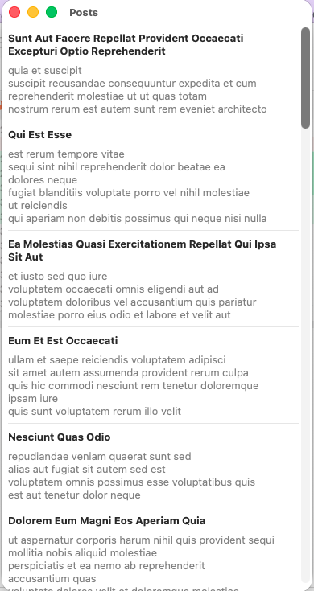
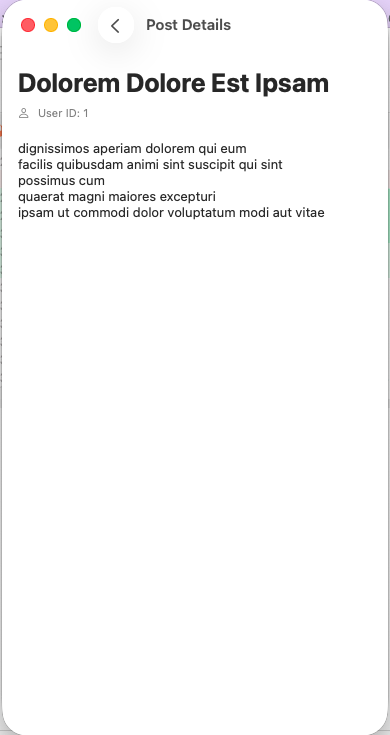

# Posts API SwiftUI App

A SwiftUI posts app that loads posts from JSONPlaceholder using a layered architecture:

- Core: API constants and networking
- Data: DTOs, remote data source, and repository implementation
- Domain: entities, repository contract, and use case
- Presentation: observable view model, posts screen, reusable post card, and detail screen

## Features

- Loads posts from `https://jsonplaceholder.typicode.com/posts`
- Displays posts in a SwiftUI list
- Opens a selected post in a detail screen
- Shows loading and error states with retry support
- Uses local preview data so SwiftUI previews do not require network access
- Supports macOS App Sandbox outgoing network connections

## Requirements

- Xcode 26 or later
- macOS 26 or later

## Run

1. Open `postsapisapp.xcodeproj` in Xcode.
2. Select the `postsapisapp` scheme.
3. Build and run the app.
4. Select any post to open its details.

## Screenshots

### Posts screen



### Post details screen



## Architecture

```text
PostScreen
    -> PostViewModel
        -> GetPostsUseCase
            -> PostRepository
                -> DefaultPostRepository
                    -> PostRemoteDataSource
                        -> APIClient
```
